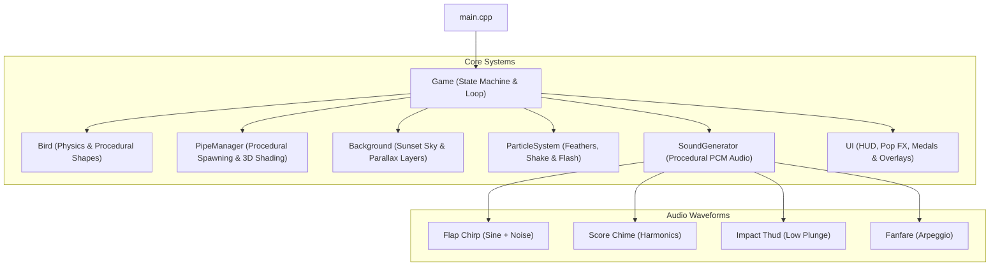

<div align="center">

# 🌅 FLAPPY BIRD — SUNSET ARCADE

<p align="center">
  
</p>

[](https://en.cppreference.com/w/cpp/20)
[](https://www.sfml-dev.org/)
[](https://cmake.org/)
[](https://github.com/thedreadlorddeath/Flappy-Bird/actions)
[](https://github.com/thedreadlorddeath/Flappy-Bird)
[](LICENSE)

<p align="center">
  <strong>An ultra-responsive, arcade-polished Flappy Bird built in modern C++ and SFML.</strong><br/>
  Featuring procedural vector bird styling, 3D glossy emerald pipes, dynamic sunset-to-twilight parallax skies, and 100% in-memory audio synthesis.
</p>

```
      \`\      /`/
       \ \    / /   ~ FLAP TO TWILIGHT ~
       (  '--'  ) 
      /  (o  o)  \   ✦ Golden Feathers ✦
     (    (__)    )  ✦ Emerald Pipes   ✦
      \  \    /  /   ✦ Neon Sunset     ✦
       `--`--'--'
```

</div>

---

## 🎨 Sunset-to-Twilight Aesthetic Palette

Unlike flat, single-color rectangles, every asset in **Sunset Arcade** is rendered with procedural vector geometry, multi-stop gradients, and cylindrical highlights:

| Layer / Object | Color Swatch & Tones | Visual Design Details |
|:---|:---|:---|
| **Dynamic Sky** | `🔴 #FF7D2D` ➔ `🟣 #181240` | Smooth vertical gradient transitioning from horizon gold to twilight purple, shifting toward deep cosmic indigo as score rises. |
| **Atmospheric Sun** | `🟡 #FFF5B4` + `🟠 #FFAF3C` | Radiant sun disc near the horizon with multi-tiered glowing atmospheric halo rings. |
| **The Bird** | `🟡 #FFCD1E` + `🔴 #E12D2D` | Golden-yellow body, cream underbelly, crimson head crest & animated flapping wing with specular eye shine and blush. |
| **Emerald Pipes** | `🟢 #22AC4A` + `💎 #8CF8B6` | 3D cylindrical shading, glossy cyan-mint highlight column on the left, deep shadow on the right, and wider beveled lip caps. |
| **Foreground Ground** | `🌱 #55D741` + `🟫 #D79B50` | Vibrant serrated neon-lime grass ribbon, warm golden-caramel soil strata, and fast-scrolling pebble accents. |

---

## ✨ Features & Game Juice

### 🎮 1. Tuned Physics & Fair Gameplay
- **$\Delta t$ (Delta-Time) Independence:** Smooth, deterministic physics at any framerate with a delta-time clamp to eliminate simulation lag spikes.
- **Fair Collision Hitboxes:** The bird's collision circle is calibrated to **~78% of visual radius** (`13.5px` vs `17.5px`), so close-call grazing through pipes feels fair and exciting.
- **Dynamic Aerodynamic Tilt:** Snaps upward (`-25°`) on flap and pitches downward into an aerodynamic nosedive (`+80°`) as gravity pulls it down.
- **Guaranteed Reachable Pipes:** Procedural pipe gap heights are clamped to a maximum step delta ($\le 140\text{px}$), preventing physically impossible pipe walls.

### 🌟 2. Juice & Visual FX
- **Glowing Feather Particle Bursts:** Every flap emits 8–12 sparkling golden, amber, and crimson particles drifting backward with drag and fading alpha.
- **Camera Trauma Shake & Flash:** Collisions trigger a damped quadratic camera shake (`shakeTrauma²`) alongside a warm golden-white impact flash.
- **Popping Score HUD:** Shadowed retro numerals at the top center pop to `1.45x` on every scored pipe before easing smoothly back to rest.

### 🔊 3. 100% In-Memory Audio Synthesis
**Zero external audio files required!** All sound effects are generated on startup into 44.1 kHz PCM buffers:
- 🪶 **Wing Flap:** Frequency-modulated chirp ($280\text{Hz} \to 540\text{Hz}$) with gentle air noise flutter.
- 🔔 **Score Chime:** Two-tone bright arcade chime ($B_5\ 987.8\text{Hz} \to E_6\ 1318.5\text{Hz}$) with bell harmonics and ringing decay.
- 💥 **Collision Impact:** Punchy downward plunge ($190\text{Hz} \to 45\text{Hz}$) with crunch noise transient.
- 🎺 **High Score Fanfare:** Ascending celebratory tri-tone jingle ($C_5 \to E_5 \to G_5$) on breaking records.

---

## 🏆 Arcade Medal Tier System

High scores persist across sessions in `highscore.txt`. Survive the pipes to earn ranked arcade medals:

| Medal | Score Range | Badge Preview | Details |
|:---:|:---:|:---:|:---|
| **Platinum** | `40+` | 💠 **PLATINUM** | Brilliant diamond-cyan sheen with central starlight core |
| **Gold** | `30 – 39` | 🥇 **GOLD** | Gleaming polished gold medallion with amber rim |
| **Silver** | `20 – 29` | 🥈 **SILVER** | Sleek chrome-silver medallion with dual ribbons |
| **Bronze** | `10 – 19` | 🥉 **BRONZE** | Warm burnished bronze badge |

---

## 📱 Android APK & Mobile Compatibility

Flappy Bird Sunset Arcade is built with native Android compatibility via SFML's `NativeActivity`:

- **Native Touch Controls:** Tap anywhere on the mobile screen to flap, start the game, or restart on Game Over.
- **Dynamic Letterboxing & Scaling:** Automatically calculates device aspect ratio to center and scale the game view on any modern mobile resolution (e.g. 19.5:9, 20:9, 16:9) without distortion.
- **Android System Fonts:** Seamlessly falls back to `/system/fonts/Roboto-Regular.ttf` or `/system/fonts/DroidSans.ttf` on mobile devices.
- **Automated CI/CD APK Build:** GitHub Actions automatically compiles the native C++ shared library with Android NDK and packages a ready-to-install `FlappyBird-SunsetArcade.apk` on every push!

### 📥 Downloading the APK
1. Go to the [**Actions Tab**](https://github.com/thedreadlorddeath/Flappy-Bird/actions) on GitHub.
2. Click on the latest workflow run.
3. Under **Artifacts**, download `FlappyBird-Android-APK`.
4. Install `FlappyBird-SunsetArcade.apk` onto your Android phone and play!

### 🛠️ Building the APK Locally
If you have the Android SDK & NDK installed:
```bash
cd android
./gradlew assembleRelease
# APK is generated at android/app/build/outputs/apk/release/app-release.apk
```

---

## 🕹️ Controls

| Action | Primary Input | Alternative Input |
|---|---|---|
| **Flap Upward** | `Space` | `Up Arrow` or `Left Mouse Click` |
| **Start Game (Get Ready)** | `Space` | `Left Mouse Click` |
| **Pause / Resume** | `P` | — |
| **Restart (Game Over)** | `R` | `Space` or `Left Mouse Click` |
| **Quit Game** | `Esc` | Window Close Button |

---

## 🏗️ Architecture & Modules

The codebase is organized cleanly into modular headers (`include/`) and implementations (`src/`):



---

## 🚀 Building & Running

### Requirements
- **C++ Compiler:** GCC 10+, Clang 11+, or MSVC 2019+ (C++17/C++20 compliant)
- **CMake:** Version 3.20 or newer
- **Git** (SFML 2.6.2 is fetched automatically on first build via CMake `FetchContent`)

### Build Steps

```bash
# 1. Clone this repository
git clone https://github.com/thedreadlorddeath/Flappy-Bird.git
cd Flappy-Bird

# 2. Configure build with CMake
cmake -B build -G "MinGW Makefiles"

# 3. Compile the executable
cmake --build build -j 4

# 4. Launch the game!
./build/FlappyBird.exe
```

> **Windows Quick Launch:** Double-click `run.bat` in the repository root to start instantly.

---

## 📁 Repository Structure

```
Flappy-Bird/
├── CMakeLists.txt        # Automated FetchContent build configuration
├── README.md             # Project documentation & visual showcase
├── run.bat               # Windows one-click launcher
├── LICENSE               # MIT License
├── .gitignore            # Git exclusion rules
├── include/
│   ├── Config.hpp        # Physics tuning, dimensions & color palette
│   ├── Game.hpp          # State management & master loop
│   ├── Bird.hpp          # Procedural bird, wing cycles & collision
│   ├── PipeManager.hpp   # 3D emerald pipes & reachability solver
│   ├── Background.hpp    # Dynamic gradient sunset & parallax
│   ├── ParticleSystem.hpp# Feather particles, screen trauma & flash
│   ├── SoundGenerator.hpp# In-memory retro waveform synthesizer
│   └── UI.hpp            # Popping score, medal cards & dialogs
└── src/
    ├── main.cpp
    ├── Game.cpp
    ├── Bird.cpp
    ├── PipeManager.cpp
    ├── Background.cpp
    ├── ParticleSystem.cpp
    ├── SoundGenerator.cpp
    └── UI.cpp
```

---

<div align="center">
  <sub>Crafted with passion in C++ & SFML. Distributed under the MIT License.</sub>
</div>
